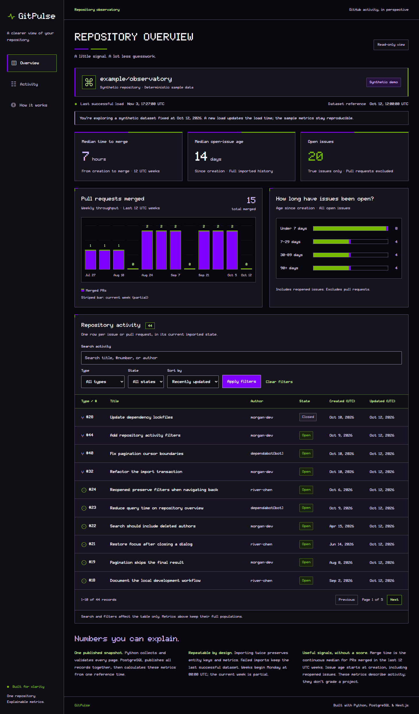

# GitPulse public release receipt — November 3, 2026

Live: **https://gitpulse.tmcsolutions-org.net/**. Owner: Russ Meredith.
The owner approved ELMO deployment and public launch. Existing ELMO, Docker,
Cloudflare and domain resources add **$0 platform subscription**; existing power,
internet, hardware and domain costs remain. This is a read-only synthetic portfolio
demo, with no GitHub token, live import, public refresh or scheduled ingestion.

## Source and resources

- Running application source: `dca6823f4567c0a5caa1c286e5d20f5ed409ace0`.
- Operator token-helper source: `510535304dfb671b5c30a5465107bdd06034b5b0`.
  Later documentation commits do not represent a new running image.
- Actual local image ID: `sha256:cf9f02b20d806d0013f9bb1dd2cebef72aa679a6de0efb4750e5b918b23393a6`.
  Its revision label is the approved application SHA. Its filesystem layers match
  a fresh build of that unchanged source, which reproduced the approved config
  digest `sha256:0bd03ca8fc773ac7fe89f269dce0fb02d4fb6a8ae8424ecfd145235171d138a3`.
  The actual image lacks the source URL label present in the verification build;
  this metadata difference is recorded, not treated as a registry digest.
- Compose project `gitpulse-public`; volume `gitpulse-public_postgres_data`;
  dedicated PostgreSQL 18 database `gitpulse_demo`. Native PG/JARVIS untouched.
- DB has no host port; app binds `127.0.0.1:3017` and receives only the reader DSN.
  Owner operations use separate file-mounted credentials. Secrets remain ignored
  in current-user/SYSTEM ACL-protected files; encryption at rest is not claimed.
- Tunnel `gitpulse-elmo`, ID `d2100870-8492-4f08-b99c-c6cdb0c6aa37`;
  published hostname routes to `http://app:3000`. Cloudflare confirmed the CNAME;
  connector readiness returned 200 with four connections.
- [PR #1](https://github.com/RussypherIOIIOI/RgitpulseR/pull/1) remains open.
  Main-branch merge was excluded from the approved deployment scope.

## Executed acceptance checks

- Public root and `/api/health`: **200**, normal TLS validation, Cloudflare edge.
  Same-origin and foreign-origin POST `/api/refresh`: **403**.
- External Exa page fetch retrieved the public dashboard and expected metrics.
- Public production browser suite: **2 passed, 1 deselected in 10.75s**.
  Verified bundled Matrix fonts, paired IRIS/NVIDIA GREEN charts on VOID plots,
  computed contrast, keyboard access, mobile overflow, search and pagination.
  Production failure-injection/manual-refresh test deliberately excluded.
- App-only restart preserved the complete checked snapshot: **44 rows**, **7h**
  median merge, **14d** median issue age, **20** open issues, **15** merged PRs;
  dataset `example/observatory`, reference `2026-10-12T12:00:00Z`;
  run `b7ae66db-c787-4ce6-aade-47d0c7816fe5`, last successful load
  `2026-11-03T17:27:00.498459+00:00`, two import runs. No reseed during this check.
- Actual reader identity and write rejection verified. Node startup does not
  migrate or seed. Production database remains private.
- Helper-source [push CI](https://github.com/RussypherIOIIOI/RgitpulseR/actions/runs/41687858818)
  and [PR CI](https://github.com/RussypherIOIIOI/RgitpulseR/actions/runs/41687866846)
  passed: 50 Python/PostgreSQL tests, three isolated browser tests, two TypeScript
  tests, lint/type/build, Python/npm runtime audits and disposable selfhost contract.
  Current PR checks additionally report subsequent documentation commits.
- Runtime audits found zero known vulnerabilities in their checked scope. Full
  npm audit retains 16 moderate development entries from one minimatch advisory;
  owner accepted the documented residual. See [security evidence](release-security.md).



## Operations and remaining limits

The deployment is usable for portfolio viewing. Availability requires ELMO,
Docker Desktop, power, internet and the domain. Windows reboot/pre-login recovery
was not tested and startup/power settings were not changed. No SLA or load-test
capacity is claimed. Owner monitoring and backups are manual.

A protected local baseline dump exists: `gitpulse-baseline-20261103T103059.dump`,
15,116 bytes; SHA256 `34b1f68e0043ca74dcbe7c58d67802cd9cae3a13f1f7360c050697509e336e5e`.
This is an on-ELMO backup, not off-host disaster recovery. Isolated same-cluster
restore passed in the test contract; production restore, fresh-cluster recovery
and production rollback were not executed. There is no earlier public release
image serving as a validated rollback target.

For health or recovery, open PowerShell 7 and run:

```powershell
Set-Location -LiteralPath 'C:\Users\david\.vscode\[personal_projects]\.ppp-gitpulse'
Invoke-RestMethod 'https://gitpulse.tmcsolutions-org.net/api/health'
docker compose --env-file deploy/selfhost.env -f deploy/selfhost.compose.yaml -p gitpulse-public ps
```

Expected: `status: ready`, app/database healthy and tunnel running. If unavailable,
check ELMO power/internet and Docker Desktop first. After Docker starts, restore
existing services without reseeding or regenerating credentials:

```powershell
docker compose --env-file deploy/selfhost.env -f deploy/selfhost.compose.yaml -p gitpulse-public --profile public up -d
```

Repeat health and dashboard checks. For suspected unsafe exposure, stop only the
connector with the same Compose arguments followed by `stop tunnel`. Preserve the
database volume and protected secrets. [Runbook cards 6–7](selfhost.md) detail
host-recovery, backup and restore procedures that require their own reviewed scope.
Do not run `down --volumes`, regenerate credentials or rerun initialization to
troubleshoot the existing deployment.
